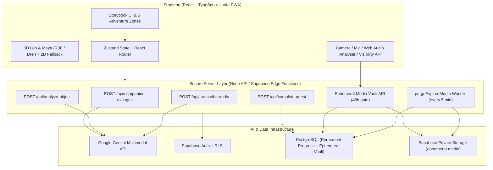

# Project Phygital — Technical Architecture

## 1. Philosophy & System Goals

**PHYGITAL — The Real-World Learning Adventure** encourages children aged 6–14 to spend less passive time on screens and more time discovering science, geography, culture, language, and healthy habits in the physical world.

Core architectural tenets:
- **Zero Secrets in Frontend**: Gemini API keys and Supabase service-role credentials live strictly server-side (Supabase Edge Functions / Node API server).
- **Strict 48-Hour Media Privacy Shield**: Raw child photos and audio recordings are isolated in `ephemeral_media_vault` and a private Storage bucket (`ephemeral-media`), never stored in permanent profile tables, blocked immediately at 48 hours via DB/RLS/API checks, and physically purged every 5 minutes by `purgeExpiredMedia`.
- **Server-Authoritative Gamification**: AI responses are schema-validated via Zod, and XP/badge/level awards are computed and persisted server-side using deterministic quest rules—never trusting client-supplied or AI-hallucinated XP numbers.
- **Honest Hardware & AI Fallbacks**: Camera, microphone, WebGL 3D, and background timer limitations are handled transparently with real fallbacks (2D animated SVG companions, typed tutoring/story entry, timestamp-based Offline Sun-Battery with PWA lifecycle disclosures, and clearly labeled Development Mode when external API keys are not configured).

---

## 2. High-Level Architecture



---

## 3. Component & Feature Map

| Layer | Modules | Responsibility |
| --- | --- | --- |
| `src/app/` | `router/`, `providers/` | Protected child/parent routing, auth & theme context, error boundary |
| `src/components/characters/` | `CompanionStage3D`, `LeoMesh`, `MayaMesh`, `Companion2DFallback` | Stylized 3D characters with 6 animation states + automatic WebGL/low-power 2D fallback |
| `src/components/layout/` | `AppShell`, `StorybookNav`, `ParentPinModal` | Mobile bottom bar, desktop rail, parent-only PIN/re-auth gate |
| `src/pages/` | `onboarding`, `home`, `adventure-zones`, `scanner`, `reverse-tutoring`, `voice-capsules`, `sound-scavenger`, `offline-missions`, `habit-mirror`, `rewards`, `parent-dashboard`, `settings` | Full interactive screens with loading, empty, and error states |
| `src/features/` | `authentication`, `quests`, `ai-dialogue`, `camera-analysis`, `audio-analysis`, `offline-battery`, `gamification`, `parental-controls`, `privacy` | Domain logic, Zod schemas, audio DSP, timestamp battery calculations |
| `server/` | `index.ts`, `gemini.ts`, `purgeWorker.ts`, `store.ts` | Local secure API server & 5-minute purge worker matching Supabase Edge Function contracts |
| `supabase/` | `migrations/001..005`, `functions/*` | Production PostgreSQL schema, RLS, private storage, Edge Functions, pg_cron schedule |

---

## 4. API Contracts

### `POST /api/companion-dialogue`
- **Auth**: Authenticated parent session + verified `child_id` ownership.
- **Request**: `{ childId, trigger, ageGroup, language, questId?, userMessage?, context? }`
  - Triggers: `reverse_tutoring | object_scan | voice_capsule | sound_scavenger | offline_battery_return | habit_completed`
- **Response (Zod-validated)**:
  ```json
  {
    "active_speaker": "both",
    "dialogue_turns": [
      {
        "character": "leo",
        "emotion": "amazed",
        "text_en": "...",
        "text_bn": "..."
      }
    ],
    "quest_completed": true,
    "xp_awarded": 20,
    "next_action": "observe",
    "animation": "celebration",
    "evaluation_summary": "...",
    "mode": "gemini | development_mock"
  }
  ```
- **Security**: `xp_awarded` is overridden by server quest rules before returning and persisting.

### `POST /api/analyze-object`
- Accepts base64 image (size-capped <= 4MB, MIME `image/jpeg|image/png|image/webp`), child age group, language, and optional ephemeral media ID.
- Returns identified everyday objects, safety notice, and an age-appropriate real-world quest. Never claims recognition on AI failure.

### `POST /api/transcribe-audio`
- Accepts audio payload (`audio/webm|audio/mp4|audio/ogg|audio/wav`, <= 10MB) and language hint (`en|bn|bilingual`).
- Returns non-judgmental transcript + optional immediate cleanup of ephemeral audio if user opted out of 48h storage.

### `POST /api/complete-quest`
- Validates quest ID / type, enforces anti-cheat bounds, calculates XP server-side (`10–30 XP`), updates `child_profiles` level & XP atomically, unlocks eligible badges, and updates `parent_quests` when applicable.

### `POST /api/ephemeral-media` & `GET /api/ephemeral-media/:id`
- Stores raw media strictly inside `ephemeral-media` private bucket + `ephemeral_media_vault` row.
- `GET` checks `expires_at > NOW()` and parent ownership before minting a short-lived (60s) signed URL; returns `410 Gone` immediately after 48h.

---

## 5. Native Mobile Integration Path (Future PWA -> Capacitor / React Native)

1. **Offline Sun-Battery**: Web PWA uses `localStorage` + server `started_at` timestamps + `visibilitychange` events. Native iOS (`DeviceActivity` / `BGAppRefreshTask`) and Android (`UsageStatsManager` / `WorkManager`) plugins can plug into `src/features/offline-battery/` via a clean adapter interface without altering UI components.
2. **AR Habit Mirror**: Web MVP uses `getUserMedia` + synchronized Canvas/SVG playful Germ & Clutter Monster overlays. Native builds can swap the `HabitOverlayRenderer` adapter to ARKit (`ARFaceTrackingConfiguration` / plane detection) and ARCore (`AugmentedFaces` / `Plane`).
