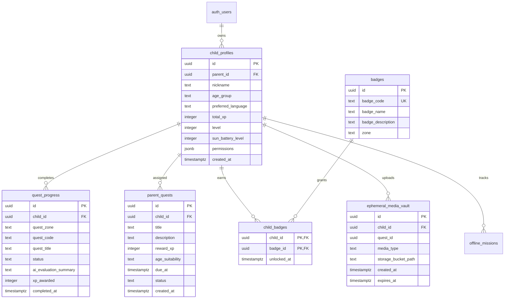

# Database Schema & Migration Design

## 1. Entity Relationship Diagram

---

## 2. Migration Breakdown (`supabase/migrations/`)

1. **`001_initial_schema.sql`**:
   - Creates `child_profiles`, `quest_progress`, `parent_quests`, `badges`, `child_badges`, `offline_missions`, and `media_purge_audit` (aggregate-only log, zero PII).
   - Enforces domain constraints: `age_group IN ('junior', 'curious', 'trailblazer')`, `preferred_language IN ('en', 'bn', 'bilingual')`, `reward_xp BETWEEN 5 AND 50`, `sun_battery_level BETWEEN 0 AND 100`.
   - Seeds the 7 core badges (`nature_detective`, `mini_scientist`, `story_keeper`, `bengali_word_wizard`, `family_explorer`, `everyday_hero`, `screen_free_champion`).

2. **`002_rls_policies.sql`**:
   - Enables Row-Level Security on all tables.
   - Helper function `public.is_child_owner(target_child_id uuid)` verifies `auth.uid() = parent_id` in `child_profiles`.
   - Restricts all reads/writes to authenticated parents owning the child profile.
   - Prevents client-side tampering on `xp_awarded` or `total_xp` directly via column/RPC design.

3. **`003_storage_setup.sql`**:
   - Creates private bucket `ephemeral-media` (`public = false`, 10MB file size limit, allowed MIME types `image/jpeg`, `image/png`, `image/webp`, `audio/webm`, `audio/ogg`, `audio/mp4`, `audio/wav`).
   - Storage RLS policies ensure users can only insert/read inside `<parent_uid>/<child_id>/...` and never list/download expired files.

4. **`004_media_expiry.sql`**:
   - Creates `ephemeral_media_vault` with:
     - `created_at TIMESTAMPTZ NOT NULL DEFAULT NOW()`
     - `expires_at TIMESTAMPTZ GENERATED ALWAYS AS (created_at + INTERVAL '48 hours') STORED`
   - Adds `idx_ephemeral_media_expires_at` index for fast 5-minute batch scans.
   - Trigger prevents `UPDATE` on `created_at` or `expires_at`.
   - RLS `SELECT` policy strictly enforces `expires_at > NOW()` so expired media becomes unreadable immediately at the exact 48-hour mark.
   - Schedules `pg_cron` (when available) to invoke `purge-expired-media` every 5 minutes (`*/5 * * * *`).

5. **`005_reward_functions.sql`**:
   - `calculate_level(xp INTEGER)` progressive level curve (`level = floor(sqrt(xp / 25)) + 1`).
   - `award_quest_xp(...)` `SECURITY DEFINER` function that validates parent ownership, enforces quest XP caps (`10–30 XP`), updates `child_profiles.total_xp` & `level`, inserts `quest_progress`, and unlocks earned badges atomically.
