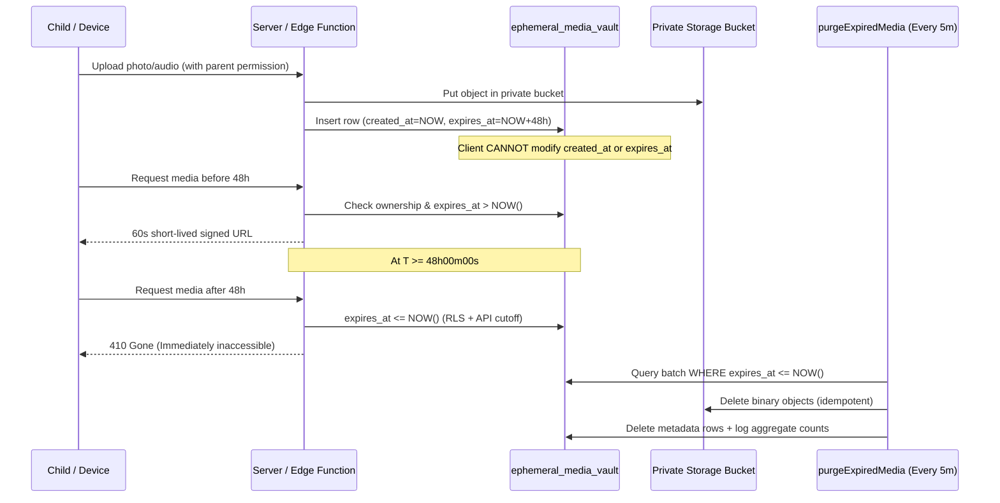

# Privacy & Child Safety Architecture (Strict 48-Hour Media Shield)

## 1. Core Privacy Principles

Project Phygital is designed for children aged 6–14 and follows data-minimization and COPPA/GDPR-K-aligned engineering safeguards:

1. **No Real Full Names Required**: Child profiles use a playful nickname (`Explorer`, `Munna`, etc.) rather than legal names, school names, birthdates, or home addresses.
2. **No Precise Geolocation**: World Explorer's Compass quests are location-independent. No GPS coordinates are requested or stored.
3. **Explicit Parental Consent Gate**: Camera, microphone, and AI companion features require parent registration and explicit permission toggles during onboarding and in Parental Controls.
4. **Adult-Participant Consent for Voice Capsules**: Before recording a family elder's story, the interface requires an explicit confirmation checkbox that the participating adult consented to the recording.
5. **Zero Continuous Background Recording**: Sound-Scavenger uses browser `AudioContext` + `AnalyserNode` locally in memory for live frequency/volume feedback and does not stream continuous background audio to servers.
6. **PII-Free AI System Instructions**: Leo and Maya are instructed never to solicit school names, full names, addresses, phone numbers, or passwords.

---

## 2. Strict 48-Hour Ephemeral Media Lifecycle

### Why Lifecycle Rules Alone Are Not Enough
Cloud object-storage lifecycle policies (e.g., "delete after 2 days") often execute asynchronously or round to UTC midnight boundaries, leaving media accessible for 48–72 hours. Phygital enforces **two independent guarantees**:
1. **Hard Access Cutoff at 48h00m00s**: Both PostgreSQL RLS (`expires_at > NOW()`) and API handlers refuse signed URLs or downloads the instant `NOW() >= expires_at`.
2. **Active Physical Purge Every 5 Minutes**: `purgeExpiredMedia` (`supabase/functions/purge-expired-media/index.ts` and `server/purgeWorker.ts`) runs every 5 minutes, deletes storage objects first, treats "already absent" (`404` / `NoSuchKey`) as idempotent success, handles partial batch failures without losing track of remaining records, logs only aggregate counts (zero child nicknames/IDs), and raises an admin alert hook if consecutive failures exceed the threshold.

---

## 3. Parent Privacy Center & Right to Delete

Inside the PIN-protected **Parent Dashboard -> Privacy Center**, parents can inspect:
- Count of active temporary media items (< 48h old)
- Upload timestamp, scheduled expiry timestamp, and live remaining retention countdown
- Last purge worker run status & deleted count
- One-click **"Purge Temporary Media Now"** button (immediate manual deletion)
- One-click **"Delete Child Profile & All Data"** button (cascade-deletes progress, badges, parent quests, ephemeral vault rows, and storage binaries)
